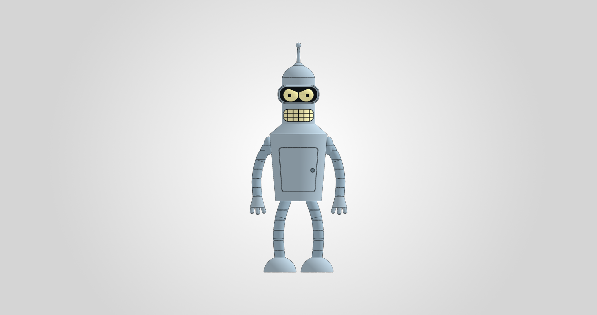
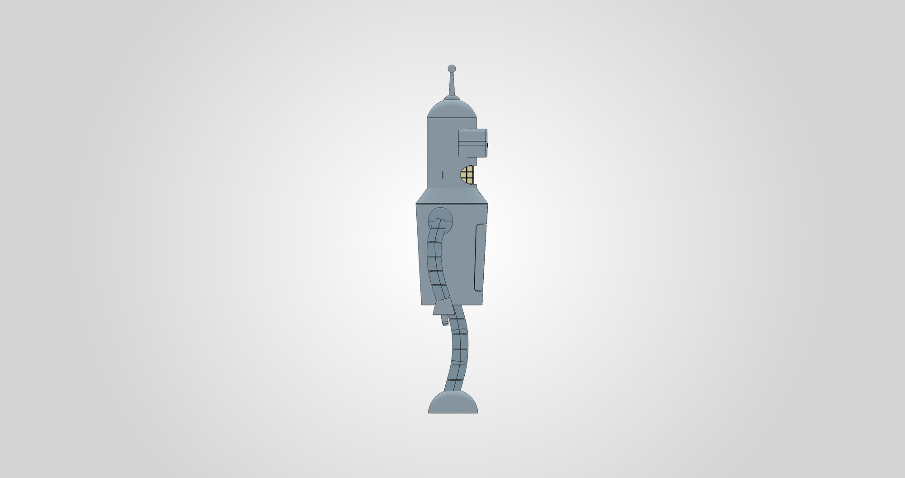
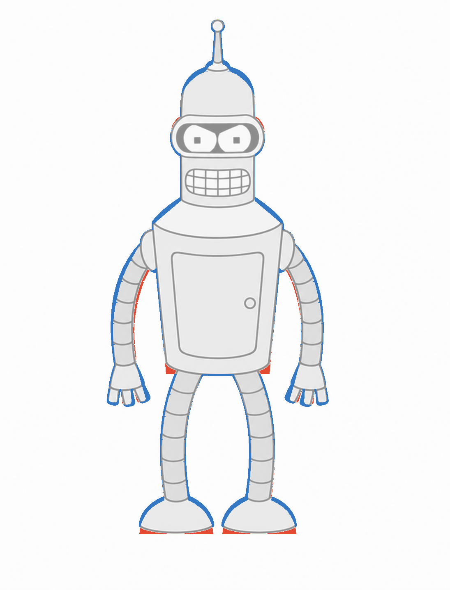
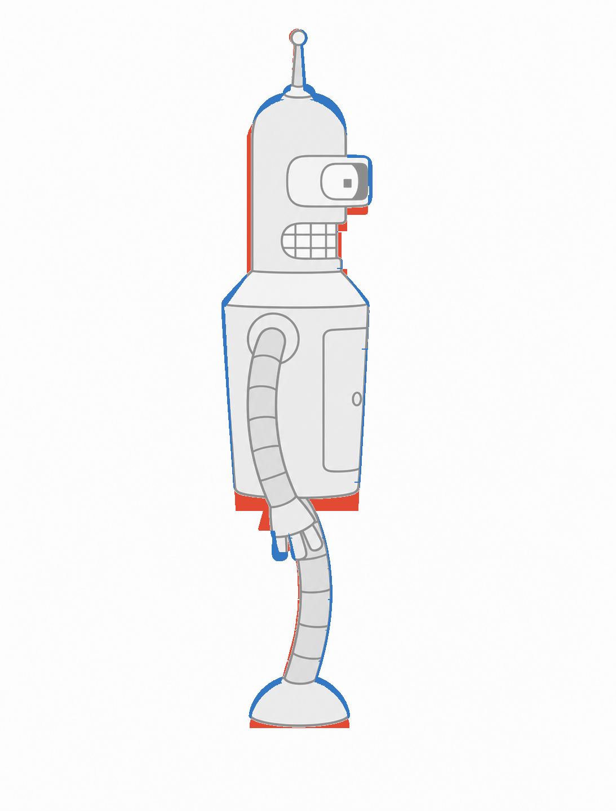
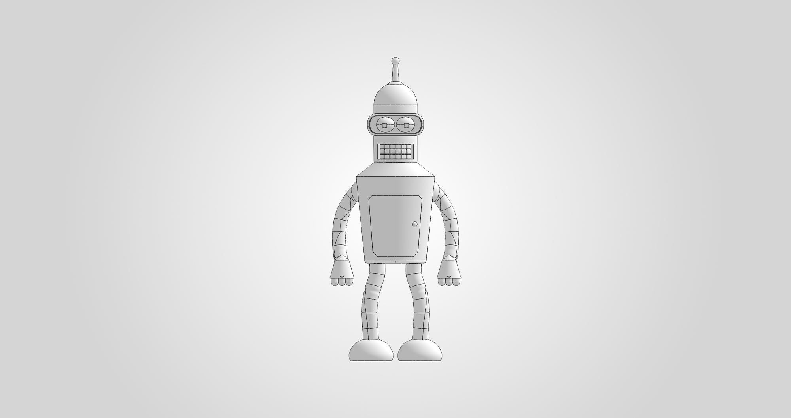
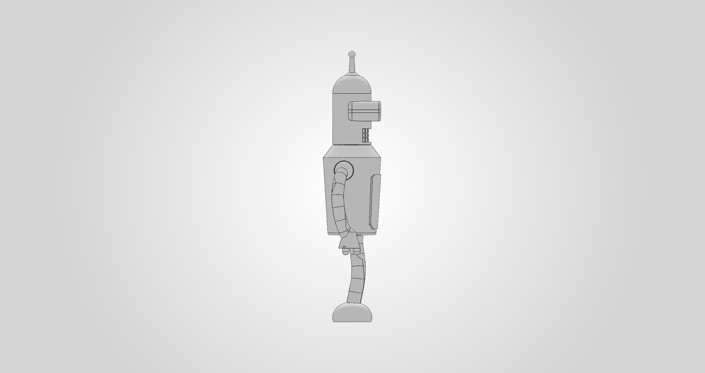

# Bender: native CAD case studies

[Overview](../README.md) · [Source programs and evidence](../examples/bender/README.md) · [Tool reference](tools.md)

Two recorded Bender runs exercise different goals: a nine-body glue assembly and
a detailed 24-body character. Both were built in SOLIDWORKS from short Python
shape programs using the MCP server. The images below are saved native views and
comparison overlays from those runs.

These are historical results from October 5–7, 2026, on versions 6.27.0–6.29.5.
The repository currently contains 6.30.0rc1. The source programs are checked with
the current interpreter, but publishing this evidence does not constitute a new
native build or a fresh 6.30.0rc1 Bender acceptance run.

## Detailed character: 24 native bodies

| Front | Left |
|---|---|
|  |  |

The October 6 run used 6.29.4 with a native-comparison serialization fix. The
model includes a curved mouth insert and tooth grid, protruding visor, convex
eyes, pupils, recessed access door, button, limb grooves and three-finger hands.
A read-only follow-up on October 7 used 6.29.5.

| Check | Recorded result | Evidence |
|---|---|---|
| Shape program | 76 components; 24 resulting solid bodies | [Program](../examples/bender/appearance-24-body/source.py), [run evidence](../examples/bender/appearance-24-body/run-evidence.json) |
| Exact native bounds | 63.53715 × 150 × 31.1 mm | [6.29.5 recheck](../examples/bender/appearance-24-body/recheck-6.29.5.json) |
| Native body health | All 24 pass `IBody2.Check3`; zero faults | [Inspection](../examples/bender/appearance-24-body/run-evidence.json) |
| Native front silhouette | IoU 0.9157; 24/24 sampled levels within 1.5 mm | [Front comparison](../examples/bender/appearance-24-body/front-comparison.json) |
| Native left silhouette | IoU 0.9059; 24/24 sampled levels within 1.5 mm | [Side comparison](../examples/bender/appearance-24-body/side-comparison.json) |
| Build duration | 96.094 s reported by the recorded operation | [Build result](../examples/bender/appearance-24-body/run-evidence.json) |
| STEP/STL delivery | Cancelled; no export acceptance claimed | Recorded run scope |

### Measured likeness

| Front overlay | Left overlay |
|---|---|
|  |  |

Red marks model area outside the reference; blue marks reference area not covered
by the model. The comparison uses a filled silhouette of the native tessellation,
aligned by bounding box and calibrated to 150 mm height. IoU is intersection over
union of those silhouettes; it is not a percentage score for individual details.
The level check allows a nearby height within the stated tolerance. The archived
JSON includes all 24 sample rows for each view.

The reference width is 64.64 mm versus 63.52 mm in the front tessellation; the
side depth is 32.47 mm versus 31.10 mm. Exact B-rep width is 63.53715 mm.
Four inspected body pairs intentionally overlap. Their failed clearance checks
describe fixed character geometry, not validated movable or glue joints. This
run does not establish print readiness, wall thickness or assembly clearances.

### A regression found by the real workload

The first native comparison finished its CAD work but the MCP connection closed
while serializing NumPy scalar values. `MeshSilhouette.bounds()` now returns
plain Python floats. The regression test checks the complete JSON-RPC envelope,
numeric counters and boolean flags for four comparison variants:

- [Native comparison transport test](../tests/test_native_comparison_transport.py)
- [Response serialization tests](../tests/test_response_serialization.py)
- [Recorded native recheck on 6.29.5](../examples/bender/appearance-24-body/recheck-6.29.5.json)

The recheck returned both native comparisons successfully, retained the original
saved Bender revision, and ended without a busy or quarantined session. The fix
is included in the current server.

## Glue assembly: nine native bodies

| Front | Left |
|---|---|
|  |  |

The October 5 run began on 6.27.0 and was rechecked and exported on 6.28.0.
Its 65-component final program produces `Torso`, `Head`, `ArmL`, `ArmR`, `LegL`,
`LegR`, `EyeL`, `EyeR` and `Teeth`. The same agent had worked on the server before
this run, so its timings are workload observations, not an independent benchmark.

The [archived assembly report](../examples/bender/printable-9-body/assembly.md)
records the following native checks:

| Check | Recorded result |
|---|---|
| Height parameter | `H=150` → 150.000 mm; `H=120` → 120.000 mm |
| Eight assembly joints | 0.250 mm clearance, no interference; `Clr` stays fixed as `H` changes |
| Stability | Centre of mass 10.2 mm inside the support footprint; tipping angle 7.9° |
| Wall inspection | Minimum reported wall 1.28 mm at the visor rim |
| Native silhouette | Front IoU about 0.95, side about 0.94; 48/48 levels per view within 2 mm |

The [delivery manifest](../examples/bender/printable-9-body/delivery-manifest.json)
separately records `EXPORT_VALIDATED`, native kernel `PASS`, and mesh structure
`PASS`. It contains one SLDPRT, one STEP with nine closed shells, and nine STL
records. Every STL passed its structural checks with zero boundary edges,
nonmanifold edges, inconsistent edges, degenerate triangles or duplicate
triangles, and `repair_performed=false`.

The export manifest deliberately leaves likeness, parameter cycling,
manufacturing clearances, wall thickness and mesh self-intersections as
`NOT_CHECKED`: export itself does not certify those properties. The first four
are discussed in the separate assembly report; mesh self-intersections remain
unverified. Physical printing and fitting were not established by this software
test. The original CAD binaries were checked against all 11 manifest hashes when
preparing this documentation; the binaries are not included in this evidence pack.

## Reproduce and inspect

Start with the [example instructions](../examples/bender/README.md). They include
both original programs, the shared approved front/side references, recorded
results, an offline compatibility check and a live workflow using new output
paths. [Provenance](../examples/bender/provenance.json) records hashes of the
published artifacts and their original source files.
